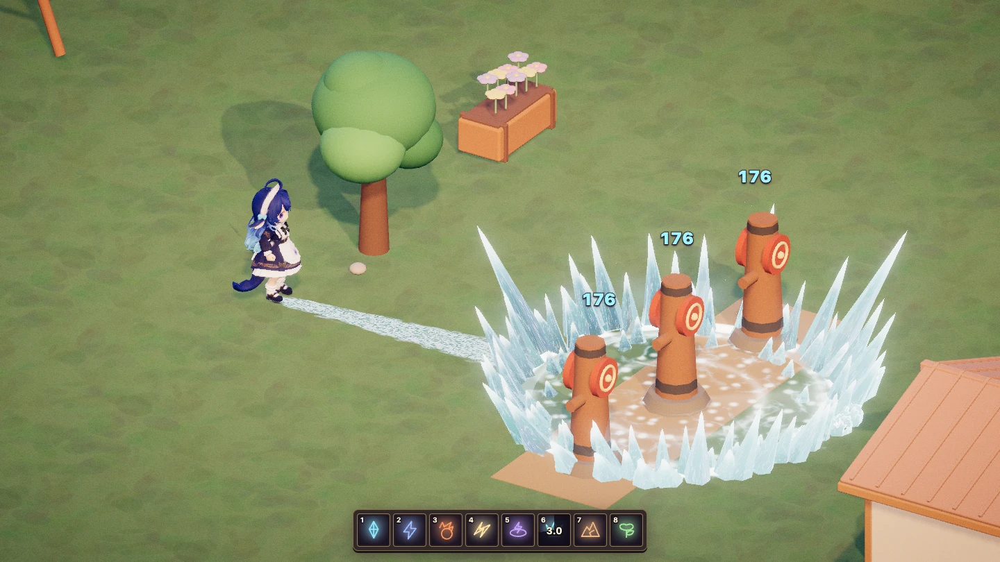
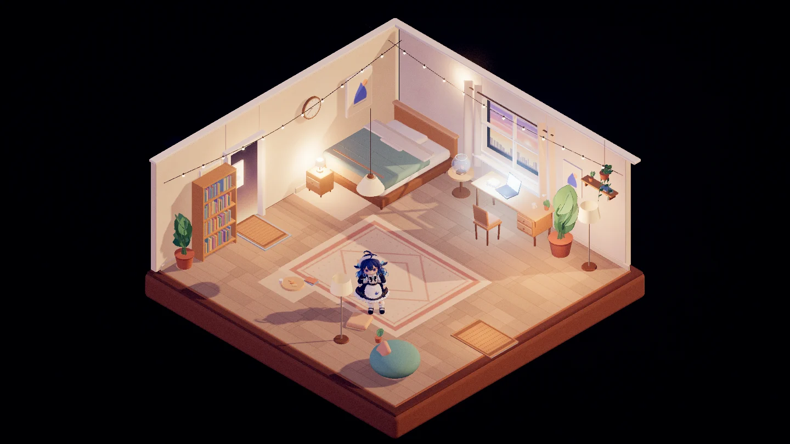
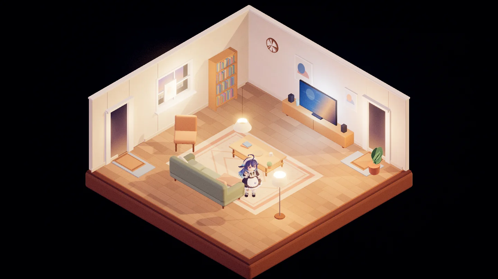
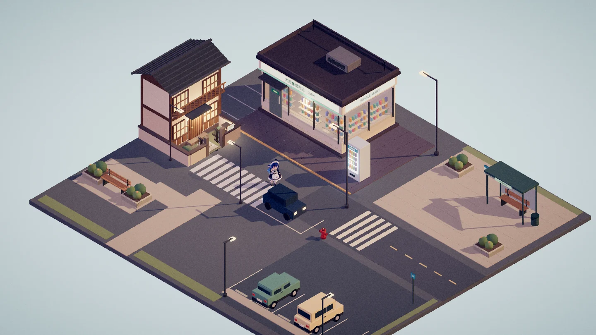
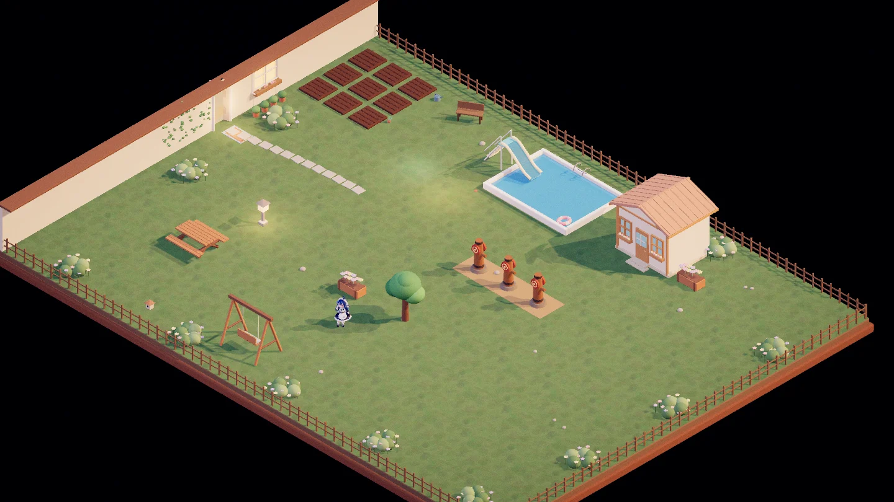
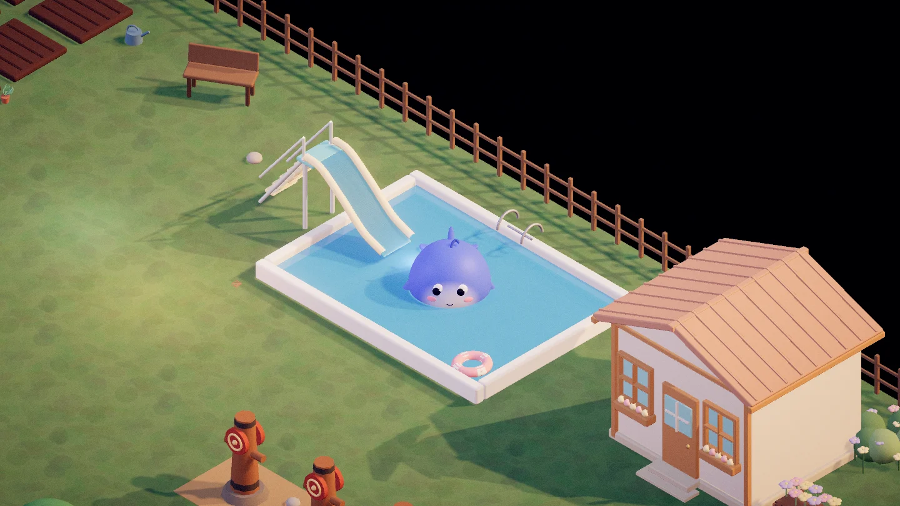
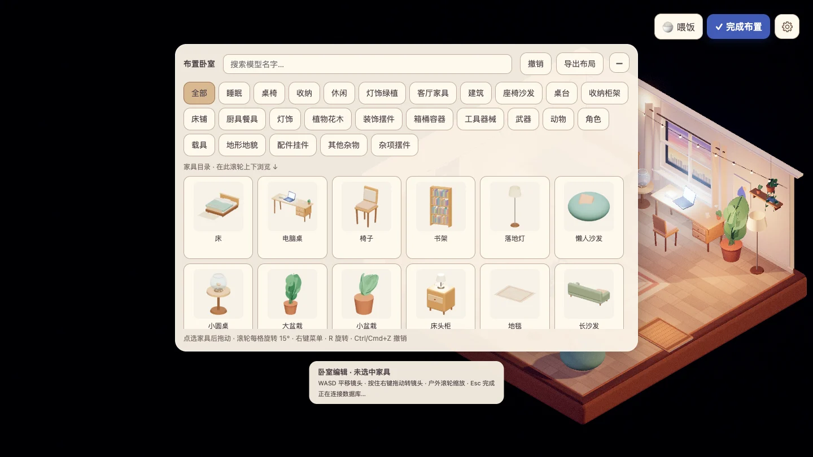

# 大肥鱼的小世界

一个用 Three.js 做的 2.5D 陪伴与世界搭建游戏。你可以和大肥鱼住在一起，布置房间，去院子里练招，或带自己的智能体来串门。

**作者 / 抖音：破晓手记**



## 开始游戏

需要 Node.js 22.13 或更新版本，推荐 Node.js 24。

### 浏览器版

从这个公开仓库克隆后，可以直接运行浏览器版。

```bash
git clone https://gitee.com/poxiao12138/dafeiyu-room.git
cd dafeiyu-room
npm ci
npm run dev
```

`npm run dev` 会启动网页和本地游戏服务。用浏览器打开 [http://127.0.0.1:5200/](http://127.0.0.1:5200/)。第一次启动会自动创建存档。

### Electron 桌面版

Electron 桌面壳单独维护。公开仓库不含 `desktop/`，所以刚克隆时请用上面的浏览器启动方式。

如果项目根目录已有 `desktop/main.cjs`，在两个终端里执行：

```bash
# 终端 1，启动本地游戏服务
npm run dev

# 终端 2，打开 Electron 窗口
npm run desktop:dev
```

两个命令都从项目根目录执行。游戏服务已经在运行时，直接执行 `npm run desktop:dev` 即可。

## 在小世界里能做什么

- **一起生活**。点击大肥鱼摸头，用右上角的「喂饭」挑食物，点击床让她睡觉。她掉进泳池会变成胖鲸鱼，上岸恢复人形。
- **布置自己的家**。打开「布置房间」，从家具目录挑选物件，拖动、旋转，摆好后保存。
- **去院子练招**。可以出拳、踢腿、翻滚、二段跳，也可以用八种魔法攻击训练木桩，看受击反馈和伤害数字。

| 按键 | 操作 |
| --- | --- |
| WASD / Shift | 移动 / 切换冲刺 |
| V / Esc | 切换等距、第一人称、第三人称视角 / 返回等距 |
| 按住鼠标右键 | 在等距和第三人称视角旋转镜头 |
| 空格 / C | 跳跃，空中再按可二段跳 / 匍匐 |
| Q / E / F | 踢腿 / 拳击 / 翻滚 |
| X / G | 坐下 / 随机跳舞 |
| 1–8 | 选中魔法，瞄准后左键施放 |

### 游戏截图

| 卧室 | 客厅 | 街角便利店 |
| --- | --- | --- |
|  |  |  |
| **院子** | **泳池变身** | **家具编辑** |
|  |  |  |

## MCP · 带你的智能体来串门

让你的智能体走进同一个小世界。它可以探索房间、和家具互动、帮你布置场景，也可以到院子里练招。你让它打哪根木桩，游戏就会负责跑位、瞄准和施法。你可以随时按 WASD 接管。

[查看 MCP 接入手册](docs/MCP-QUICKSTART.md)

## 公开资源与本机素材

公开版自带大肥鱼的角色模型和动画、四个初始场景、内置音效，以及 146 个 Polyfork 精选模型与缩略图。全量模型库和个人存档保存在本机。想扩展小镇或海滩，可以在游戏里导入自有素材包。

[本地素材导入](docs/LOCAL-ASSETS.md) · [存档与默认世界](docs/WORLD-SAVES.md) · [提交与发布检查](docs/RELEASING.md)

## 开发与许可

- `npm run build` 后执行 `npm start`，可以运行生产构建。
- `npm run check` 运行测试、构建和公开资源检查。
- [文档目录](docs/README.md)收录开发、验收和兼容说明。

项目代码和作者有权授权的资源采用 [MIT License](LICENSE)。Polyfork 精选模型按 CC BY 4.0 分发，逐项署名见 [Polyfork 署名](resources/polyfork/CREDITS.md)。其他素材和依赖的来源见 [第三方声明](THIRD-PARTY-NOTICES.md)。
